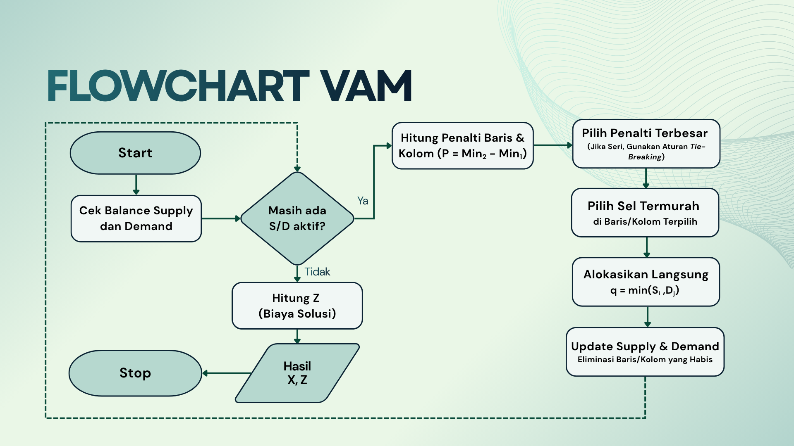
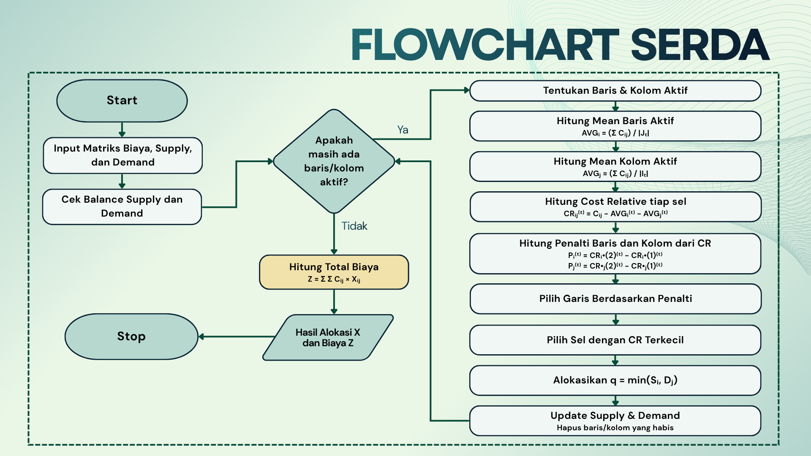

# SERDA Method: Dynamic Mean-Opportunity Vogel's Approximation Method

> SERDA Method - Kelompok 5 - Riset Operasi (T)

  | Nama     | NRP      |
  |----------|----------|
  | Erica Triana Widyastuti | 5025241069 |
  | Dilbina Windi Azahra | 5025241180 |
  | Isabella Sienna Sulisthio | 5025241199 |
  | Nasyita Larasati Ertyananda | 5025241201 |
  | Rahma Sakinah | 5025241222 |

Repository ini berisi implementasi dari beberapa metode penyelesaian **Transportation Problem (TP)** dalam menentukan **Initial Basic Feasible Solution (IBFS)**, serta sistem pengujian otomatis (*automated benchmarking*) untuk mengevaluasi kinerja setiap metode. 

Fokus utama repository ini adalah membandingkan metode **VAM Standar (Vogel's Approximation Method)** dengan pengembangannya, yaitu **SERDA Method (Dynamic Mean-Opportunity Vogel's Approximation Method / DMO-VAM)**. Selain kedua metode tersebut, pengujian juga melibatkan 6 metode IBFS lainnya. Seluruh metode dievaluasi menggunakan **69 testcase standar** dengan membandingkan hasilnya terhadap solusi optimal eksak yang telah diverifikasi secara independen.

---

## Daftar Isi
- [Perbandingan Algoritma VAM Standar vs SERDA Method](#perbandingan-algoritma-vam-standar-vs-serda-method)
  - [1. Langkah Algoritma VAM Standar](#1-langkah-algoritma-vam-standar)
  - [2. Langkah Algoritma SERDA Method](#2-langkah-algoritma-serda-method)
  - [3. Perbandingan Pseudocode VAM Standar dan SERDA Method](#3-perbandingan-pseudocode-vam-standar-dan-serda-method)
  - [4. Implementasi Kode Inti `(src/SERDA.c)`](#4-implementasi-kode-inti-srcserdac)
  - [5. Tracing Eksekusi Program Step-by-Step](#5-tracing-eksekusi-program-step-by-step)
    - [5.1 Tracing Kasus Standar: `G1_N01.txt`](#51-tracing-kasus-standar-g1_n01txt)
    - [5.2 Tracing Kasus Perangkap Biaya VAM: `G3_N35.txt`](#52-tracing-kasus-perangkap-biaya-vam-g3_n35txt)
    - [5.3 Tracing Kasus Penalti Kolom Dini: `G2_N14.txt`](#53-tracing-kasus-penalti-kolom-dini-g2_n14txt)
- [Panduan Teknis Penggunaan Repositori](#panduan-teknis-penggunaan-repositori)
  - [6. Ringkasan 8 Metode yang Dibandingkan](#6-ringkasan-8-metode-yang-dibandingkan)
  - [7. Struktur Direktori](#7-struktur-direktori)
  - [8. Prasyarat Sistem & Kompilasi (`make all`, `make clean`)](#8-prasyarat-sistem--kompilasi)
  - [9. Menjalankan Automated Benchmark](#9-menjalankan-automated-benchmark)
  - [10. Menjalankan Program Secara Mandiri](#10-menjalankan-program-secara-mandiri)
  - [11. Format Input & Output](#11-format-input--output)
  - [12. Formula dan Metrik Evaluasi](#12-formula-dan-metrik-evaluasi)
- [Hasil Pengujian & Analisis Komparasi](#hasil-pengujian--analisis-komparasi)
  - [13. Ringkasan Hasil Benchmark (69 Testcase)](#13-ringkasan-hasil-benchmark-69-testcase)
  - [14. Tabel Perbandingan Lengkap: VAM vs SERDA vs Optimal (69 TC)](#14-tabel-perbandingan-lengkap-vam-vs-serda-vs-optimal-69-tc)
  - [15. Kesimpulan Komparasi VAM vs SERDA](#15-kesimpulan-komparasi-vam-vs-serda)

---

# Perbandingan Algoritma VAM Standar vs SERDA Method

## 1. Langkah Algoritma VAM Standar

Algoritma *Vogel's Approximation Method* (VAM) klasik bekerja berdasarkan prinsip penalti (*opportunity cost*) yang dihitung dari selisih dua elemen biaya terkecil pada setiap baris dan kolom:

1. **Inisialisasi & Penyeimbangan Masalah (Balancing)**:
   - Hitung total suplai $\sum S_i$ dan total permintaan $\sum D_j$.
   - Jika $\sum S_i > \sum D_j$, tambahkan kolom *dummy* dengan biaya 0 dan permintaan sebesar $\sum S_i - \sum D_j$.
   - Jika $\sum D_j > \sum S_i$, tambahkan baris *dummy* dengan biaya 0 dan suplai sebesar $\sum D_j - \sum S_i$.
2. **Hitung Penalti Tiap Baris dan Kolom Aktif**:
   - Untuk setiap baris aktif $i$, cari biaya terendah pertama ($c^{(1)}_i$) dan kedua ($c^{(2)}_i$):
     $$\text{Penalti Baris } P_i = c^{(2)}_i - c^{(1)}_i$$
   - Untuk setiap kolom aktif $j$, cari biaya terendah pertama ($c^{(1)}_j$) dan kedua ($c^{(2)}_j$):
     $$\text{Penalti Kolom } P_j = c^{(2)}_j - c^{(1)}_j$$
3. **Pilih Garis dengan Penalti Terbesar**:
   - Tentukan baris atau kolom dengan nilai penalti maksimum: $\max(P_i, P_j)$.
   - Aturan *tie-breaking*: Jika terdapat penalti bernilai sama, implementasi standar memilih kandidat baris/kolom pertama yang ditemukan.
4. **Pilih Sel Biaya Minimum pada Garis Terpilih**:
   - Pada baris/kolom terpilih tersebut, pilih sel $(i, j)$ dengan biaya transportasi asli terkecil:
     $$\min C_{ij}$$
5. **Alokasikan Kuantitas Transportasi**:
   - Hitung nilai alokasi:
     $$q = \min(S_i, D_j)$$
   - Kurangi suplai dan permintaan: $S_i \leftarrow S_i - q$, $D_j \leftarrow D_j - q$.
   - Jika $S_i = 0$, baris $i$ dieliminasi dari iterasi berikutnya.
   - Jika $D_j = 0$, kolom $j$ dieliminasi dari iterasi berikutnya.
6. **Iterasi**:
   - Ulangi langkah 2 sampai 5 hingga seluruh kapasitas suplai dan permintaan habis teralokasi.

### Flowchart Algoritma VAM Standar
Berikut adalah diagram alir eksekusi VAM standar:



---

## 2. Langkah Algoritma SERDA Method

*Dynamic Mean-Opportunity Vogel's Approximation Method* (SERDA) memodifikasi perhitungan penalti dan seleksi sel menggunakan deviasi terhadap rata-rata baris dan kolom aktif (*Dynamic Mean Opportunity*) serta menerapkan hierarki *tie-breaking* deterministik:

1. **Inisialisasi & Penyeimbangan Masalah**:
   - Periksa total suplai dan permintaan. Tambahkan baris/kolom *dummy* berbiaya 0 bila masalah tidak seimbang.


2. **Hitung Rata-rata Biaya Baris & Kolom Aktif:**
   - **Rata-rata baris aktif:** $AVG_i = \frac{\sum_{j \in J} C_{ij}}{|J|}$  
     Dengan $J$ adalah himpunan kolom aktif dan $|J|$ adalah jumlah kolom aktif.

   - **Rata-rata kolom aktif:** $AVG_j = \frac{\sum_{i \in I} C_{ij}}{|I|}$  
     Dengan $I$ adalah himpunan baris aktif dan $|I|$ adalah jumlah baris aktif.

3. **Transformasi Matriks Biaya Relatif ($CR_{ij}$)**:
   - Hitung biaya relatif untuk setiap sel aktif $(i, j)$:
     $$CR_{ij} = C_{ij} - AVG_i - AVG_j$$
4. **Hitung Penalti Baris & Kolom berbasis biaya relatif $CR$**:
   - Cari dua nilai $CR$ terkecil pada setiap baris aktif dan kolom aktif.
   - Penalti baris: $P_i = CR^{(2)}_i - CR^{(1)}_i$.
   - Penalti kolom: $P_j = CR^{(2)}_j - CR^{(1)}_j$.
5. **Seleksi Garis Terpilih (Tie-Breaking 4 Tingkat)**:
   - Evaluasi seluruh baris dan kolom aktif menggunakan kriteria terurut berikut:
     1. Prioritas 1: **Penalti Terbesar** ($\max \text{Penalty}$).
     2. Prioritas 2 (*Tie*): **Nilai Min $CR$ Terkecil** ($\min CR$, ascending).
     3. Prioritas 3 (*Tie*): **Baris diprioritaskan dibanding Kolom** (`is_row == 1` mendahului `is_row == 0`).
     4. Prioritas 4 (*Tie*): **Indeks terkecil** (ascending index).
6. **Seleksi Sel pada Garis Terpilih (Tie-Breaking 3 Tingkat)**:
   - Pada baris atau kolom yang terpilih, tentukan sel $(i, j)$ berdasarkan kriteria:
     1. Prioritas 1: **Nilai $CR_{ij}$ terkecil**.
     2. Prioritas 2 (*Tie*): **Biaya Transportasi Asli $C_{ij}$ terkecil**.
     3. Prioritas 3 (*Tie*): **Indeks terkecil**.
7. **Alokasi & Pembaruan Sisa Kapasitas**:
   - Alokasikan $q = \min(S_i, D_j)$ pada sel terpilih.
   - Perbarui sisa stok $S_i \leftarrow S_i - q$ dan sisa permintaan $D_j \leftarrow D_j - q$.
   - Eliminasi baris jika $S_i = 0$ dan eliminasi kolom jika $D_j = 0$.
8. **Ulangi langkah 2–7 hingga seluruh permintaan terpenuhi.**

### Flowchart Algoritma SERDA Method
Berikut adalah diagram alir eksekusi SERDA Method (DMO-VAM):



---

## 3. Perbandingan Pseudocode VAM Standar dan SERDA Method

Tabel berikut merangkum perbedaan prinsip komputasi antara VAM standar dan SERDA Method:

| Aspek Algoritma | VAM Standar | SERDA Method (DMO-VAM) |
| :--- | :--- | :--- |
| **Metrik Biaya Penalti** | Biaya Transportasi Asli ($c_{(2)} - c_{(1)}$) | Biaya Relatif Dinamis ($CR^{(2)} - CR^{(1)}$) |
| **Perhitungan Deviasi Rata-rata** | Tidak ada | $AVG_i$ (baris aktif) dan $AVG_j$ (kolom aktif) dihitung tiap iterasi |
| **Matriks Biaya yang Digunakan** | Matriks biaya asli $C_{ij}$ | Matriks peluang biaya relatif $CR_{ij} = C_{ij} - AVG_i - AVG_j$ |
| **Aturan Tie-Breaking Garis** | Arbitrary / Garis pertama ditemukan | 4 Tingkat: Penalti terbesar $\to$ Min $CR$ $\to$ Baris $\to$ Indeks terkecil |
| **Aturan Tie-Breaking Sel** | Minimum biaya asli $C_{ij}$ | 3 Tingkat: Min $CR$ $\to$ Min biaya asli $C_{ij}$ $\to$ Indeks terkecil |

### 3.1 Pseudocode VAM Standar
```text
function solve_VAM(C, supply, demand):
  balance_problem(C, supply, demand)
  
  while supply_left > 0:
    // 1. Hitung Penalti Biaya Asli
    for each active row i:
      P[i] = second_min(C[i]) - min(C[i])
    for each active col j:
      Q[j] = second_min(C[:][j]) - min(C[:][j])
    
    // 2. Pilih Penalti Terbesar
    line = max(P, Q)
    
    // 3. Pilih Sel Biaya Minimum
    if line is row:
      j = argmin_{j in active_cols}(C[line][j])
      sel = (line, j)
    else:
      i = argmin_{i in active_rows}(C[i][line])
      sel = (i, line)
    
    // 4. Alokasikan Unit
    q = min(supply[sel.i], demand[sel.j])
    alloc[sel.i][sel.j] += q
    supply[sel.i] -= q
    demand[sel.j] -= q
    eliminate_zero_lines()

  return alloc, total_cost
```

### 3.2 Pseudocode SERDA Method (DMO-VAM)
```text
function solve_SERDA(C, supply, demand):
  balance_problem(C, supply, demand)
  
  while supply_left > 0:
    // 1. Hitung Rata-rata Baris & Kolom Aktif
    for each active row i:
      row_mean[i] = mean(C[i][active_cols])
    for each active col j:
      col_mean[j] = mean(C[active_rows][j])
      
    // 2. Transformasi CR & Penalti CR
    for each active row i:
      CR[i][*] = C[i][*] - row_mean[i] - col_mean[*]
      P[i] = second_min(CR[i]) - min(CR[i])
      min_cr_row[i] = min(CR[i])
    for each active col j:
      CR[*][j] = C[*][j] - row_mean[*] - col_mean[j]
      Q[j] = second_min(CR[:][j]) - min(CR[:][j])
      min_cr_col[j] = min(CR[:][j])
      
    // 3. Seleksi Garis Terbaik (Tie-break 4 Tingkat)
    line = select_best_line(
             P, Q, min_cr, priority:
             1. Max Penalty
             2. Min CR terkecil
             3. Baris sebelum kolom
             4. Indeks terkecil
           )
           
    // 4. Seleksi Sel Terbaik (Tie-break 3 Tingkat)
    sel = select_best_cell(
            line, priority:
            1. Min CR
            2. Min Original Cost C[i][j]
            3. Indeks terkecil
          )
          
    // 5. Alokasikan Unit
    q = min(supply[sel.i], demand[sel.j])
    alloc[sel.i][sel.j] += q
    supply[sel.i] -= q
    demand[sel.j] -= q
    eliminate_zero_lines()

  return alloc, total_cost
```

---

## 4. Implementasi Kode Inti `(src/SERDA.c)`

Logika algoritma SERDA diimplementasikan dalam berkas [`src/SERDA.c`](src/SERDA.c). Berikut adalah komponen fungsi utamanya:

### A. Struktur Data Kandidat Garis & Comparator Tie-Breaking
```c
typedef struct {
    int is_row;     /* 1 jika baris, 0 jika kolom */
    int idx;        /* indeks baris atau kolom */
    double penalty; /* selisih elemen CR terkecil kedua - terkecil pertama */
    double min_cr;  /* nilai CR terkecil pada garis */
} LineCandidate;

/* Comparator pembanding garis kandidat pada SERDA:
 * 1. Penalti terbesar (descending)
 * 2. Min CR terkecil (ascending)
 * 3. Baris sebelum kolom (is_row = 1 sebelum 0)
 * 4. Indeks terkecil (ascending)
 */
static int cmp_line_candidates(const void *a, const void *b) {
    const LineCandidate *la = (const LineCandidate *)a;
    const LineCandidate *lb = (const LineCandidate *)b;

    if (fabs(la->penalty - lb->penalty) > EPSILON) {
        return (la->penalty > lb->penalty) ? -1 : 1;
    }
    if (fabs(la->min_cr - lb->min_cr) > EPSILON) {
        return (la->min_cr < lb->min_cr) ? -1 : 1;
    }
    if (la->is_row != lb->is_row) {
        return la->is_row ? -1 : 1;
    }
    return (la->idx < lb->idx) ? -1 : (la->idx > lb->idx ? 1 : 0);
}
```

### B. Perhitungan Rata-rata Aktif dan Nilai $CR_{ij}$
```c
/* 1. Menghitung rata-rata baris dan kolom aktif */
for (int ri = 0; ri < n_active_r; ri++) {
    int i = active_r[ri];
    double sum = 0.0;
    for (int cj = 0; cj < n_active_c; cj++) {
        sum += prob->cost[i][active_c[cj]];
    }
    row_mean[i] = sum / (double)n_active_c;
}

for (int cj = 0; cj < n_active_c; cj++) {
    int j = active_c[cj];
    double sum = 0.0;
    for (int ri = 0; ri < n_active_r; ri++) {
        sum += prob->cost[active_r[ri]][j];
    }
    col_mean[j] = sum / (double)n_active_r;
}

/* 2. Menghitung matriks CR dan menentukan penalti baris */
for (int ri = 0; ri < n_active_r; ri++) {
    int i = active_r[ri];
    for (int cj = 0; cj < n_active_c; cj++) {
        int j = active_c[cj];
        cr_vals[cj] = prob->cost[i][j] - row_mean[i] - col_mean[j];
    }
    qsort(cr_vals, n_active_c, sizeof(double), cmp_double);
    lines[n_lines].is_row = 1;
    lines[n_lines].idx = i;
    lines[n_lines].penalty = (n_active_c >= 2) ? (cr_vals[1] - cr_vals[0]) : 0.0;
    lines[n_lines].min_cr = cr_vals[0];
    n_lines++;
}
```

### C. Pemilihan Sel pada Garis Terpilih
```c
/* Memilih sel pada baris terpilih berdasarkan Min CR -> Min Cost Asli -> Min Indeks */
if (chosen_line.is_row) {
    sel_i = chosen_line.idx;
    double best_cr = DBL_MAX;
    double best_cost = DBL_MAX;
    for (int cj = 0; cj < n_active_c; cj++) {
        int j = active_c[cj];
        double cr = prob->cost[sel_i][j] - row_mean[sel_i] - col_mean[j];
        double c = prob->cost[sel_i][j];
        int is_better = 0;
        if (cr < best_cr - EPSILON) {
            is_better = 1;
        } else if (fabs(cr - best_cr) <= EPSILON) {
            if (c < best_cost - EPSILON) {
                is_better = 1;
            } else if (fabs(c - best_cost) <= EPSILON) {
                if (sel_j == -1 || j < sel_j) is_better = 1;
            }
        }
        if (is_better) {
            best_cr = cr;
            best_cost = c;
            sel_j = j;
        }
    }
}
```


# Hasil Pengujian & Analisis Komparasi

## 13. Ringkasan Hasil Benchmark (69 Testcase)

Tabel berikut menyajikan rekapitulasi performa 8 metode yang diuji terhadap seluruh 69 testcase standar:

| Peringkat | Metode | Optimal Hits | Akurasi (%) | Mean Gap (%) | Median Gap (%) | Max Gap (%) | Std Dev (%) | Avg Time (ms) |
|:---:|:---|:---:|:---:|:---:|:---:|:---:|:---:|:---:|
| 1 | **SERDA** | **57 / 69** | **82.61%** | **0.45%** | **0.00%** | **9.49%** | **1.53%** | 0.101 ms |
| 2 | **SAM** | 48 / 69 | 69.57% | 2.12% | 0.00% | 21.53% | 4.26% | 0.174 ms |
| 3 | **CSM** | 45 / 69 | 65.22% | 2.53% | 0.00% | 32.66% | 5.35% | 0.159 ms |
| 4 | **RBSM** | 45 / 69 | 65.22% | 2.33% | 0.00% | 28.31% | 4.77% | 0.290 ms |
| 5 | **IHW** | 40 / 69 | 57.97% | 4.44% | 0.00% | 66.99% | 10.41% | 0.638 ms |
| 6 | **VAM** | 36 / 69 | 52.17% | 3.57% | 0.00% | 21.14% | 5.44% | 0.406 ms |
| 7 | **THP** | 29 / 69 | 42.03% | 5.19% | 1.22% | 72.73% | 11.27% | 0.015 ms |
| 8 | **FVAM** | 28 / 69 | 40.58% | 4.19% | 0.41% | 48.33% | 7.46% | 0.130 ms |

### Perbandingan Runtime Setiap Metode

Tabel berikut menyajikan peringkat efisiensi waktu eksekusi (*runtime*) dari masing-masing metode yang diuji pada seluruh 69 testcase:

| Peringkat | Metode | Rata-rata Waktu (ms) | Total Waktu Eksekusi (69 TC) |
|:---:|:---|---:|---:|
| 1 | **THP** | 0.0145 ms | 1.00 ms |
| 2 | **SERDA** | 0.1014 ms | 7.00 ms |
| 3 | **FVAM** | 0.1304 ms | 9.00 ms |
| 4 | **CSM** | 0.1594 ms | 11.00 ms |
| 5 | **SAM** | 0.1739 ms | 12.00 ms |
| 6 | **RBSM** | 0.2899 ms | 20.00 ms |
| 7 | **VAM** | 0.4058 ms | 28.00 ms |
| 8 | **IHW** | 0.6377 ms | 44.00 ms |

---

## 14. Tabel Perbandingan Hasil Lengkap: VAM vs SERDA vs Optimal (69 TC)

Berikut adalah data komparasi biaya antara VAM standar, SERDA Method, dan Solusi Optimal Eksak pada 69 berkas testcase:

> **Catatan**: Tanda bintang (`*`) menandakan bahwa metode menghasilkan biaya yang identik dengan nilai solusi optimal eksak.

| No | Test Case | VAM Cost | SERDA Cost | Solusi Optimal | Keterangan Perbandingan |
|:---:|:---|---:|---:|---:|:---|
| 1 | `G1_N01.txt` | 5600* | 5600* | 5600 | Keduanya Optimal |
| 2 | `G1_N12.txt` | 425* | 425* | 425 | Keduanya Optimal |
| 3 | `G1_N21.txt` | 4205* | 4205* | 4205 | Keduanya Optimal |
| 4 | `G1_P07.txt` | 327 | 291* | 291 | SERDA Optimal, VAM Suboptimal (+12.37%) |
| 5 | `G1_P11.txt` | 600* | 600* | 600 | Keduanya Optimal |
| 6 | `G1_P17.txt` | 490 | 475* | 475 | SERDA Optimal, VAM Suboptimal (+3.16%) |
| 7 | `G1_P18.txt` | 555* | 555* | 555 | Keduanya Optimal |
| 8 | `G1_P19.txt` | 1500 | 1390* | 1390 | SERDA Optimal, VAM Suboptimal (+7.91%) |
| 9 | `G2_N02.txt` | 28* | 28* | 28 | Keduanya Optimal |
| 10 | `G2_N14.txt` | 960 | 920* | 920 | SERDA Optimal, VAM Suboptimal (+4.35%) |
| 11 | `G2_N15.txt` | 156* | 156* | 156 | Keduanya Optimal |
| 12 | `G2_N22.txt` | 12075* | 12075* | 12075 | Keduanya Optimal |
| 13 | `G2_N23.txt` | 23* | 23* | 23 | Keduanya Optimal |
| 14 | `G2_P12.txt` | 180* | 180* | 180 | Keduanya Optimal |
| 15 | `G3_N31.txt` | 1480* | 1480* | 1480 | Keduanya Optimal |
| 16 | `G3_N33.txt` | 1430 | 1250* | 1250 | SERDA Optimal, VAM Suboptimal (+14.40%) |
| 17 | `G3_N35.txt` | 320 | 280* | 280 | SERDA Optimal, VAM Suboptimal (+14.29%) |
| 18 | `G3_P02.txt` | 2850* | 2850* | 2850 | Keduanya Optimal |
| 19 | `G3_P03.txt` | 149* | 149* | 149 | Keduanya Optimal |
| 20 | `G3_P04.txt` | 450* | 450* | 450 | Keduanya Optimal |
| 21 | `G3_P09.txt` | 845* | 845* | 845 | Keduanya Optimal |
| 22 | `G3_P13.txt` | 3210* | 3210* | 3210 | Keduanya Optimal |
| 23 | `G3_P20.txt` | 3320* | 3320* | 3320 | Keduanya Optimal |
| 24 | `G3_S07.txt` | 326 | 305* | 305 | SERDA Optimal, VAM Suboptimal (+6.89%) |
| 25 | `G4_N07.txt` | 1220 | 1165 | 1160 | SERDA lebih mendekati optimal |
| 26 | `G4_N10.txt` | 990 | 910* | 910 | SERDA Optimal, VAM Suboptimal (+8.79%) |
| 27 | `G4_N11.txt` | 2980 | 2460* | 2460 | SERDA Optimal, VAM Suboptimal (+21.14%) |
| 28 | `G4_N16.txt` | 1590 | 1510* | 1510 | SERDA Optimal, VAM Suboptimal (+5.30%) |
| 29 | `G4_N17.txt` | 779 | 743* | 743 | SERDA Optimal, VAM Suboptimal (+4.85%) |
| 30 | `G4_N25.txt` | 849 | 809* | 809 | SERDA Optimal, VAM Suboptimal (+4.94%) |
| 31 | `G4_N29.txt` | 3857* | 3857* | 3857 | Keduanya Optimal |
| 32 | `G4_P01.txt` | 605* | 605* | 605 | Keduanya Optimal |
| 33 | `G5_N06.txt` | 8350 | 7750* | 7750 | SERDA Optimal, VAM Suboptimal (+7.74%) |
| 34 | `G5_N13.txt` | 5125 | 4525* | 4525 | SERDA Optimal, VAM Suboptimal (+13.26%) |
| 35 | `G5_N18.txt` | 1745 | 1650* | 1650 | SERDA Optimal, VAM Suboptimal (+5.76%) |
| 36 | `G5_N24.txt` | 3520 | 3460* | 3460 | SERDA Optimal, VAM Suboptimal (+1.73%) |
| 37 | `G5_N27.txt` | 68804 | 59356* | 59356 | SERDA Optimal, VAM Suboptimal (+15.92%) |
| 38 | `G5_N28.txt` | 2090* | 2090* | 2090 | Keduanya Optimal |
| 39 | `G5_N30.txt` | 473 | 465* | 465 | SERDA Optimal, VAM Suboptimal (+1.72%) |
| 40 | `G6_N04.txt` | 1580* | 1580* | 1580 | Keduanya Optimal |
| 41 | `G6_N09.txt` | 114 | 111* | 111 | SERDA Optimal, VAM Suboptimal (+2.70%) |
| 42 | `G6_N32.txt` | 1820 | 1820 | 1780 | Keduanya Suboptimal Seimbang |
| 43 | `G6_N34.txt` | 510* | 510* | 510 | Keduanya Optimal |
| 44 | `G6_P05.txt` | 290* | 290* | 290 | Keduanya Optimal |
| 45 | `G6_P10.txt` | 212* | 212* | 212 | Keduanya Optimal |
| 46 | `G6_RBSM1.txt` | 18855* | 18855* | 18855 | Keduanya Optimal |
| 47 | `G6_RBSM2.txt` | 153500* | 153500* | 153500 | Keduanya Optimal |
| 48 | `G6_S04.txt` | 3150 | 3150 | 3125 | Keduanya Suboptimal Seimbang |
| 49 | `G7_N03.txt` | 1104 | 1103 | 1102 | SERDA lebih mendekati optimal |
| 50 | `G7_N05.txt` | 470 | 415 | 410 | SERDA lebih mendekati optimal |
| 51 | `G7_N26.txt` | 490* | 502 | 490 | VAM Optimal |
| 52 | `G7_P06.txt` | 49* | 49* | 49 | Keduanya Optimal |
| 53 | `G7_P08.txt` | 11000 | 10625* | 10625 | SERDA Optimal, VAM Suboptimal (+3.53%) |
| 54 | `G7_P14.txt` | 175* | 175* | 175 | Keduanya Optimal |
| 55 | `G7_P15.txt` | 12810 | 10830* | 10830 | SERDA Optimal, VAM Suboptimal (+18.28%) |
| 56 | `G7_P16.txt` | 340 | 325* | 325 | SERDA Optimal, VAM Suboptimal (+4.62%) |
| 57 | `G8_RBSM3.txt` | 1044180* | 1044180* | 1044180 | Keduanya Optimal |
| 58 | `G8_RBSM4.txt` | 93351 | 92259 | 92212 | SERDA sangat dekat ke optimal (Gap 0.05%) |
| 59 | `G8_RBSM5.txt` | 116020* | 116020* | 116020 | Keduanya Optimal |
| 60 | `G8_S01.txt` | 5148 | 5302 | 5067 | Keduanya Suboptimal |
| 61 | `G8_S02.txt` | 1089 | 1098 | 1080 | Keduanya Suboptimal |
| 62 | `G8_S03.txt` | 948 | 969 | 885 | Keduanya Suboptimal |
| 63 | `G8_S05.txt` | 1801 | 1600 | 1586 | SERDA lebih baik (Gap 0.88% vs 13.55%) |
| 64 | `G8_S06.txt` | 5409 | 5022 | 4702 | SERDA lebih baik (Gap 6.80% vs 15.03%) |
| 65 | `G9_R1.txt` | 12928429* | 12928429* | 12928429 | Keduanya Optimal |
| 66 | `G9_R2.txt` | 13657053* | 13657053* | 13657053 | Keduanya Optimal |
| 67 | `G9_R3.txt` | 12296587* | 12296587* | 12296587 | Keduanya Optimal |
| 68 | `G9_R4.txt` | 14117586* | 14117586* | 14117586 | Keduanya Optimal |
| 69 | `G9_R5.txt` | 14017419* | 14017419* | 14017419 | Keduanya Optimal |

---

## 15. Kesimpulan Komparasi VAM vs SERDA

Berdasarkan hasil pengujian empiris terhadap 69 testcase standar:

1. **Akurasi Solusi Optimal**:
   Algoritma SERDA menghasilkan solusi optimal pada **57 dari 69 testcase (82.61%)**, dibandingkan VAM standar yang mencapai **36 dari 69 testcase (52.17%)**. Terdapat 21 kasus uji di mana SERDA berhasil mencapai solusi optimal sementara VAM menghasilkan nilai suboptimal.
2. **Tingkat Deviasi (Optimality Gap)**:
   Rata-rata deviasi biaya (*Mean Gap*) pada SERDA tercatat sebesar **0.45%**, lebih rendah dibandingkan VAM standar yang memiliki *Mean Gap* sebesar **3.57%**.
3. **Stabilitas Deviasi Terburuk (*Max Gap*)**:
   Deviasi terbesar (*Max Gap*) yang dihasilkan oleh VAM mencapai **21.14%** (terjadi pada kasus `G4_N11.txt`), sedangkan deviasi terbesar pada SERDA tidak melampaui **9.49%**.
4. **Waktu Komputasi**:
   Rata-rata waktu eksekusi SERDA berada pada kisaran **0.101 ms** per kasus uji, setara dengan VAM standar (**0.406 ms**). Hal ini menunjukkan bahwa penambahan komputasi rata-rata dinamis dan aturan *tie-breaking* bertingkat tidak membebani efisiensi waktu komputasi secara nyata dan tetap berada dalam kelas kompleksitas polinomial $O(N^2 M + NM^2)$.
   
---